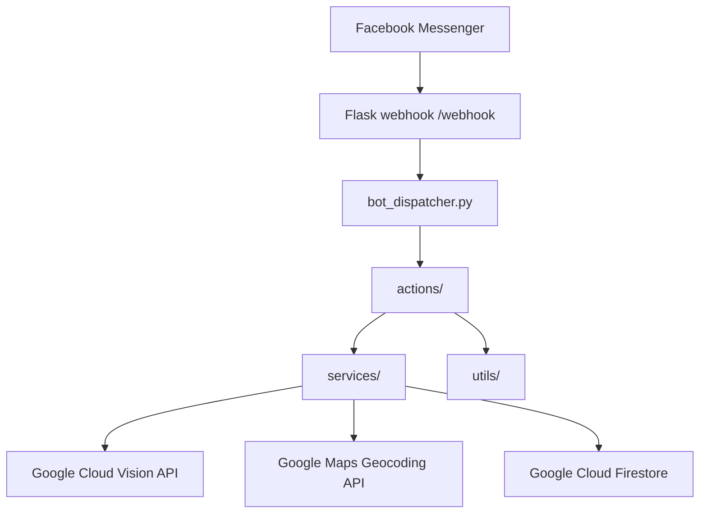

# BikeR Cyclone 🚲

**An AI-assisted Facebook Messenger chatbot for reporting abandoned and unusable bicycles in Taiwan.**

BikeR Cyclone is a conversational reporting prototype built for the BikeR community initiative. Its Messenger assistant, **Cyclone**, helps people submit bicycle reports through a guided chat flow: upload a photo, identify the location, confirm the details, and save the report for later review.

The project brings together **computer vision, optical character recognition (OCR), geocoding, and cloud-backed conversation state management** in a single application.

## Features

- **Messenger-based reporting:** Interactive buttons and messages guide users through each step.
- **Bicycle photo recognition:** Google Cloud Vision label detection checks whether an uploaded image contains a bicycle.
- **Doorplate OCR:** Google Cloud Vision extracts text from a photo of a nearby address plate.
- **Address lookup:** Google Maps Geocoding API resolves typed or OCR-extracted addresses.
- **Rule-based report scoring:** Address completeness influences the score and whether the chatbot presents a lower-score confirmation path.
- **Persistent conversation state:** Firestore stores user profiles, conversation states, and report records.
- **Report history:** Users can view reports, open details, and withdraw reports. Withdrawn reports are copied to a backup collection.
- **User engagement:** A credit and level system summarizes participation.

**Scope of the image recognition:** The Vision API identifies whether a photo appears to contain a bicycle. It does **not** determine whether the bicycle is broken, abandoned, or eligible for removal. Likewise, report scoring is rule-based rather than a trained ML classifier.

## Reporting workflow

1. **Start a report.** The user enters the flow in Facebook Messenger and supplies a name and contact number.
2. **Upload a bicycle photo.** The bot calls Google Cloud Vision to look for a bicycle label.
3. **Provide a location.** The user types an address or uploads a doorplate image for OCR.
4. **Verify the address.** Google Maps Geocoding returns a formatted address; the user may add location details.
5. **Review the score.** The bot scores the address using formatting and address-component checks, then asks the user to confirm.
6. **Save the report.** Firestore stores the report and updates the user's participation statistics.
7. **Manage reports.** The user can review their history and withdraw a report.

The lower-score path currently displays a message about manual processing. **A separate human-review queue and automated email delivery are not implemented in the `dev` branch.**

## Architecture



The application separates **event routing**, **conversation actions**, **external integrations**, and **shared validation and UI utilities** so individual responsibilities are easier to maintain.

## Technology stack

| Area | Technologies |
| --- | --- |
| Language and API | Python, Flask, Gunicorn |
| Messaging | Facebook Messenger, Meta Graph API |
| Vision and OCR | Google Cloud Vision API |
| Location | Google Maps Geocoding API |
| Database | Google Cloud Firestore |

## Repository layout

```text
.
├── main.py                 # Flask app and Messenger webhook routes
├── bot_dispatcher.py       # Incoming event routing and conversation dispatch
├── constants.py            # Conversation states and postback payloads
├── actions/
│   ├── navigation.py       # Menus and informational messages
│   ├── recycling.py        # Photo, address, and report submission flow
│   ├── reports.py          # View and withdraw reports
│   └── user.py             # Profile, statistics, and feedback interactions
├── services/
│   ├── ai_service.py       # Bicycle detection and doorplate OCR
│   ├── db_service.py       # Firestore user/report operations
│   └── map_services.py     # Geocoding and address details
├── utils/
│   ├── scoring.py          # Address scoring rules
│   ├── ui_factory.py       # Messenger text and button templates
│   └── validators.py       # Input validation
├── messenger/              # Messenger API client utilities
├── requirements.txt
└── .gcloudignore
```


## Getting started

### Prerequisites

- A compatible Python environment and `pip`
- A Facebook Page and Messenger app access token, with a webhook configured for your app
- A Google Cloud project with **Vision API** and **Firestore** access
- A Google Maps Geocoding API key
- Google Cloud Application Default Credentials or a service-account credential available to the process
- Publicly accessible URLs for the bot's image assets

### Configure environment variables

The code expects the following variables:

| Variable | Purpose |
| --- | --- |
| `ACCESS_TOKEN` | Messenger Page access token |
| `VERIFY_TOKEN` | Verification token for the Messenger webhook |
| `GOOGLE_API_KEY` | Google Maps Geocoding API key |
| `GOOGLE_APPLICATION_CREDENTIALS` | Optional path to a Google Cloud service-account JSON file (if using that authentication method) |
| `GREAT`, `SORRY`, `DOORPLATE`, `STOP` | Image URLs required by the Messenger UI |
| `LETSGO`, `RECYCLE`, `CRY` | Additional image URLs used in the chat flow |
| `PORT` | Optional Flask listening port; defaults to `5000` |


## Why this project

BikeR Cyclone explores how a conversational interface can simplify a civic reporting workflow. Instead of requiring users to navigate a separate form, the bot collects relevant details step by step and uses cloud services to reduce manual image and address entry.

---
